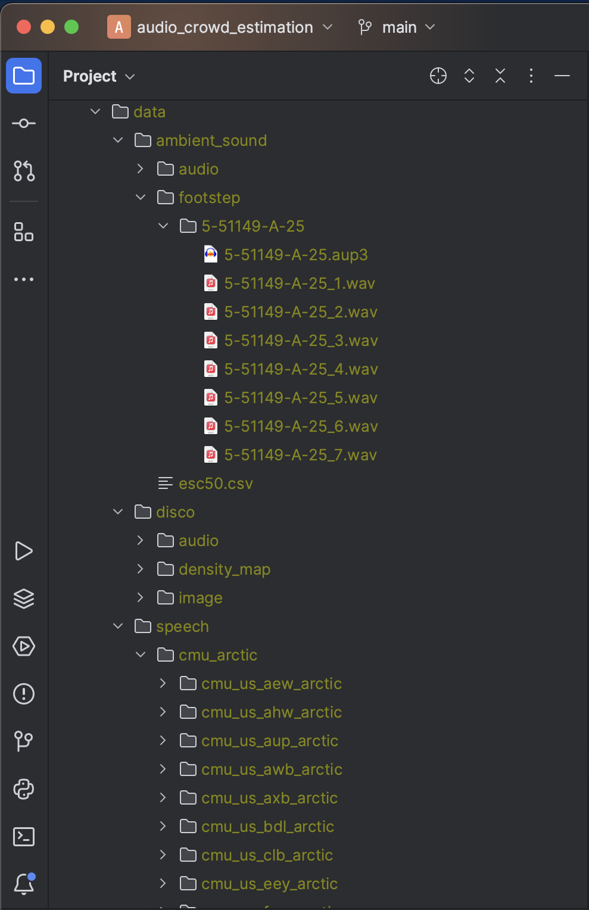

# audio_crowd_estimation

足音を中心とした環境音から、マイク周辺の人数（混雑度）を推定するための研究用コードです。
人流軌跡データ（実測データ／シミュレーション）に足音を割り当てて音響シミュレーションを行い、
得られた音声と人数の組から深層学習モデル（CNN / Transformer など）を学習・評価します。

```
 公開人流データ ──(database.datasets.*)──> PostgreSQL + PostGIS ──(database.crowd_data)──┐
                                                                                         ├─> 人流軌跡CSV
 軌跡シミュレーション(ランダム歩行 / Social Force) ──(simulation.crowd_trajectory)───────┘
        │
        ▼ preprocess.footstep_sound -opt foot_tag     （足音・身長・歩幅を付与）
 足音タグ付き軌跡CSV
        │
        ▼ simulation.crowd_audio -opt footstep        （pyroomacoustics で受音信号を生成）
 音声WAV + 距離別人数CSV + signal_info.json
        │
        ▼ analysis.model_training -c <JSON>           （学習 / 推論 / Optuna / ファインチューニング）
 学習済みモデル・評価結果
```

## 目次
- [ディレクトリ構成とドキュメント](#ディレクトリ構成とドキュメント)
- [インストール](#インストール)
- [共通の約束事](#共通の約束事)
- [データ準備](#データ準備)
- [処理の流れ](#処理の流れ)
- [コマンド一覧](#コマンド一覧)
- [テスト](#テスト)
- [既知の問題](#既知の問題)

## ディレクトリ構成とドキュメント

コマンドの詳しい使い方（オプション、JSON 設定、出力）は各ディレクトリの README.md に記載しています。

| ディレクトリ | 内容 | ドキュメント |
| --- | --- | --- |
| `database/` | PostgreSQL + PostGIS からの人流軌跡エクスポート、ROI・マイク・グリッドの作成 | [database/README.md](database/README.md)、[database/script.md](database/script.md) |
| `database/datasets/` | 公開人流データ（ETH, DUT, Edinburgh, Grand Central）の DB 取り込み | [database/datasets/README.md](database/datasets/README.md) |
| `simulation/` | 人流軌跡シミュレーション、足音の音響シミュレーション | [simulation/README.md](simulation/README.md) |
| `preprocess/` | 足音セグメンテーション・足音タグ付与、特徴量計算、DISCO データの前処理 | [preprocess/README.md](preprocess/README.md) |
| `analysis/` | モデルの学習・推論・Optuna 探索、AFPILD 評価 | [analysis/README.md](analysis/README.md) |
| `tools/` | パイプライン実行、設定 JSON の一括生成、結果集計、可視化、実録音データの処理 | [tools/README.md](tools/README.md) |
| `video/` | 動画・録音アノテーションからの人数データ作成 | [video/README.md](video/README.md) |
| `gui/` | 音声と軌跡を同期再生する Jupyter 用プレイヤー | [gui/README.md](gui/README.md) |
| `model/` | モデル定義（`SimpleCNN2`, `MultiChannelSimpleCNN`, `Conv1dTransformer`, `ASTRegressor`, `LeastSquareModel` など） | [analysis/README.md](analysis/README.md#model_param-の主なキー) |
| `common/` | ロガー、足音音源設定（`EnvSoundConfig`, `FootTagSetting`）、NMFD などの共通処理 | |
| `template/` | 各処理の JSON 設定テンプレート | 各 README から参照 |
| `script/` | 丸の内データに対する一括実行シェルスクリプトの例（一部古いオプションを使用） | |
| `footstep_config.json` | 足音音源ごとのファイル名・足音区間・路面種別の設定 | [preprocess/README.md](preprocess/README.md#-opt-segment足音セグメンテーション) |
| `data/`, `workspace/` | 入力データ・中間生成物・学習結果の置き場（Git 管理外） | |

## インストール

Python 3.12.9 以上を想定しています（`.python-version` 参照）。

- macOS（`psycopg2-binary` を使用）
```bash
python -m venv venv
source venv/bin/activate
pip install -r requirement-mac.txt
```

- CPU 環境（`psycopg2` をソースからビルドするため PostgreSQL のクライアントライブラリが必要）
```bash
python -m venv venv
source venv/bin/activate
pip install -r requirement-cpu.txt
```

- Windows + GPU（CUDA 12.1 版 PyTorch）
```bash
python -m venv venv
venv\Scripts\activate
pip install -r requirement-gpu.txt
```

共通の依存パッケージは `requirement/common.txt`（numpy, scipy, librosa, pyroomacoustics, geopandas, sqlalchemy, optuna, lightgbm, shap など）にまとめています。
`soundfile` や `tqdm` など一部パッケージは requirements に明記されていないため、ImportError が出た場合は個別にインストールしてください。
PostgreSQL からデータを抽出・取り込みする場合は、PostgreSQL + PostGIS 環境が別途必要です。

## 共通の約束事

- コマンドは **リポジトリのルート** から `python -m <パッケージ>.<モジュール>` の形式で実行します（`analysis/afpild_*.py` のみスクリプト直接実行）。
- 各コマンドのオプションは `-h` で確認できます。
- 多くの処理は JSON 設定の `task_list` に複数タスクを列挙して一括実行できます。共通値はトップレベル（または `param`）に、個別値は各タスクに書き、**タスク側の値が優先** されます。
- 多くの一括処理は、出力が既に存在するタスクを **スキップ** します。再実行したい場合は JSON に `"overwrite": true` を指定するか、出力を削除してください。
- DB 接続オプション（`-dh/-dp/-du/-dw/-dn`）の既定値は `localhost:5432`、ユーザー・パスワードとも `postgres` です。
- 座標系はメートル単位の平面座標を想定しています。

## データ準備

1. **環境音（ESC-50）**：https://github.com/karolpiczak/ESC-50 からダウンロードし、`audio/` 以下の WAV を `data/ambient_sound/audio/` に配置します。
2. **足音のセグメンテーション**：各音源を 1 歩ずつの WAV に分割します（詳細は [preprocess/README.md](preprocess/README.md)）。
   ```bash
   python -m preprocess.footstep_sound -opt segment -i ./data/ambient_sound/audio -o ./data/ambient_sound/footstep
   ```
3. **人流データ**：公開データを DB に取り込む（[database/datasets/README.md](database/datasets/README.md)、[database/script.md](database/script.md)）か、シミュレーションで生成します（[simulation/README.md](simulation/README.md)）。
4. **音声データ（CMU ARCTIC、任意）**
   ```python
   from simulation.util import Data
   Data.get_cmu_arctic()
   ```

データフォルダ構成：



## 処理の流れ

代表的な実行例です。各ステップの詳細はリンク先を参照してください。

| ステップ | コマンド例 | 詳細 |
| --- | --- | --- |
| 1. 人流軌跡の取得（DB から） | `python -m database.crowd_data -opt json -ic template/database/01_export_csv.json` | [database/README.md](database/README.md) |
| 1'. 人流軌跡の取得（シミュレーション） | `python -m simulation.crowd_trajectory -c template/simulation/trajectory/sfm_crowd_trajectory.json` | [simulation/README.md](simulation/README.md) |
| 2. 足音タグの付与 | `python -m preprocess.footstep_sound -opt json -ic template/database/02_add_foot_tag.json` | [preprocess/README.md](preprocess/README.md) |
| 3. 音響シミュレーション | `python -m simulation.crowd_audio -opt footstep -i template/simulation/audio/atc/atc_footstep_simulation_template.json` | [simulation/README.md](simulation/README.md) |
| 4. モデル学習 | `python -m analysis.model_training -c template/model_train/SimpleCNN2/sfm2atc_cnn_f5_d3.json` | [analysis/README.md](analysis/README.md) |
| 5. 結果の集計 | `python -m tools.compare_model_training -g ./workspace/model/train/asphalt -o ./workspace/model/compare.csv` | [tools/README.md](tools/README.md) |

複数のステップを 1 つの JSON にまとめて実行する場合は `python -m tools.pipeline <JSON>` を使います（[tools/README.md](tools/README.md)）。

## コマンド一覧

| コマンド | 内容 | 詳細 |
| --- | --- | --- |
| `python -m database.datasets.<eth\|dut\|edinburgh\|gc>_datasets` | 公開人流データの DB 取り込み | [database/datasets/README.md](database/datasets/README.md) |
| `python -m database.crowd_data` | DB から人流軌跡を CSV にエクスポート | [database/README.md](database/README.md) |
| `python -m database.layout_data` | ROI・マイク・グリッドのシェープファイル作成 | [database/README.md](database/README.md) |
| `python -m simulation.crowd_trajectory` | 人流軌跡シミュレーション | [simulation/README.md](simulation/README.md) |
| `python -m simulation.crowd_audio` | 音響シミュレーション | [simulation/README.md](simulation/README.md) |
| `python -m preprocess.footstep_sound` | 足音セグメンテーション・足音タグ付与 | [preprocess/README.md](preprocess/README.md) |
| `python -m preprocess.sim_data` | シミュレーション出力の特徴量計算 | [preprocess/README.md](preprocess/README.md) |
| `python -m preprocess.disco_data` | DISCO データセットの前処理 | [preprocess/README.md](preprocess/README.md) |
| `python -m analysis.model_training` | 学習・推論・Optuna 探索・ファインチューニング | [analysis/README.md](analysis/README.md) |
| `python -m analysis.export_least_square_csv` | 最小二乗法用の CSV 出力 | [analysis/README.md](analysis/README.md) |
| `python analysis/afpild_*.py` | AFPILD データでのシミュレーション評価 | [analysis/README.md](analysis/README.md) |
| `python -m tools.pipeline` | 複数処理の一括実行 | [tools/README.md](tools/README.md) |
| `python -m tools.create_sim_json` | シミュレーション設定 JSON の一括生成 | [tools/README.md](tools/README.md) |
| `python -m tools.compare_model_training` | 複数モデルの精度の集計 | [tools/README.md](tools/README.md) |
| `python -m tools.output_acc_from_result` | 正解値の範囲を限定した精度の出力 | [tools/README.md](tools/README.md) |
| `python -m tools.visualize` | log-mel / スペクトログラム / 散布図 | [tools/README.md](tools/README.md) |
| `python -m tools.crowd_histogram` | 距離別人数分布の可視化 | [tools/README.md](tools/README.md) |
| `python -m tools.create_heatmap_gif` | グリッド人数のヒートマップ動画 | [tools/README.md](tools/README.md) |
| `python -m tools.create_calibrated_dataset` | 実録音を学習用フォルダ形式に変換 | [tools/README.md](tools/README.md) |
| `python -m tools.denoise` | 雑音除去 | [tools/README.md](tools/README.md) |
| `python -m video.create_crowd_from_annotation` | WAV 切り出し・アノテーション展開 | [video/README.md](video/README.md) |
| `python -m video.test_annotate_feet` | 足首位置検出のテスト | [video/README.md](video/README.md) |
| `from gui import SyncPlayer` | 音声・軌跡同期プレイヤー（Jupyter） | [gui/README.md](gui/README.md) |

## テスト

```bash
python -m unittest discover -s gui/tests
```
```bash
python -m analysis.test_least_square_training
```

GUI の実ブラウザ検証については [gui/README.md](gui/README.md) を参照してください。

## 既知の問題

コードを読んで見つかった、使うときに注意が必要な点です。詳細は各 README の「注意点」に記載しています。

| 箇所 | 内容 | 詳細 |
| --- | --- | --- |
| `template/simulation/trajectory/random_crowd_trajectory.json` | `option` が `crowd_trajectory` になっており、何も実行されない（`random` が正しい） | [simulation/README.md](simulation/README.md#注意点) |
| `template/simulation/audio/` の多く（11ファイル） | `max_orders` と書かれているが、読まれるキーは `max_order`（反射次数が 0 になる） | [simulation/README.md](simulation/README.md#注意点) |
| `preprocess.footstep_sound` の `foot_tag_all` | 引数が逆順で渡されており動作しない | [preprocess/README.md](preprocess/README.md#注意点) |
| `tools.create_sim_json -opt sfm_trj` | 呼び出し引数が不足しており CLI から動作しない | [tools/README.md](tools/README.md#注意点) |
| `analysis.model_training` の `-opt` / `-d` | 受け付けるが使われない（JSON の `option` / `device` を使用） | [analysis/README.md](analysis/README.md#注意点) |
| `template/model_tuning/` の一部 | `option` がなく `train` として実行されエラーになる | [analysis/README.md](analysis/README.md#注意点) |
| `script/` の一部 | 旧 CLI や存在しないテンプレートを使用 | |
| `database/script.md` | `csv2shp`、`-bs` の記載は誤りで、正しくは `csv2mic`、`-bf` | [database/README.md](database/README.md#注意点) |
